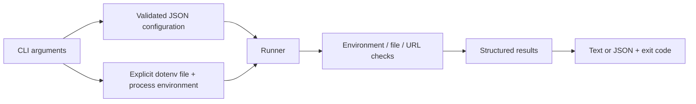

# Architecture

## Boundaries

- `config.ts` reads JSON, rejects unknown fields and invalid types, applies defaults and anchors file paths to the configuration directory.
- `environment.ts` loads only an explicitly requested file and merges process values last. Windows names are case-insensitive; environment maps have no prototype.
- `checks.ts` performs checks and returns stable result codes. HTTP probes require opt-in, validate every redirect and share one timeout budget.
- `runner.ts` aggregates every result in environment/file/URL order, continuing after individual failures.
- `report.ts` formats results without resolved secrets. `cli.ts` owns output and process exit codes.

## Result contract

Successful checks use `ENV_OK`, `FILE_OK`, `URL_VALID` (syntax only) or `URL_OK` (probe). Failures use `ENV_MISSING`, `FILE_NOT_REGULAR`, `FILE_UNREADABLE`, `URL_INVALID`, `URL_STATUS`, `URL_TIMEOUT`, `URL_REDIRECT_LIMIT` or `URL_REQUEST_FAILED`.

Invocation errors use `ARGS_INVALID`, `CONFIG_INVALID`, `ENV_FILE_INVALID` or `INTERNAL_ERROR`. Reports intentionally contain declared names, not resolved values. File accessibility is a point-in-time check; it cannot guarantee a later deployment sees the same state.

## Tests

Native Node tests exercise the compiled production modules. Real subprocess tests cover argument parsing, output and exit codes; real local HTTP servers cover request behavior. A tarball test installs the packed CLI into a temporary project and executes its generated bin shim, including the `--env-file` option.

The shebang uses `env -S node --` so Node does not interpret the CLI's dotenv flag itself. Unix systems therefore need an `env` supporting `-S`; GitHub's Linux runner provides this. Remote CI is the authority for the published platform matrix.
